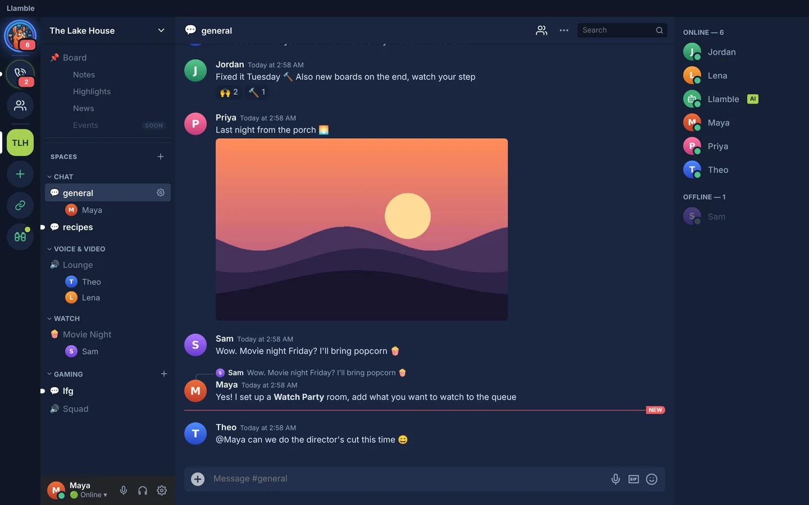
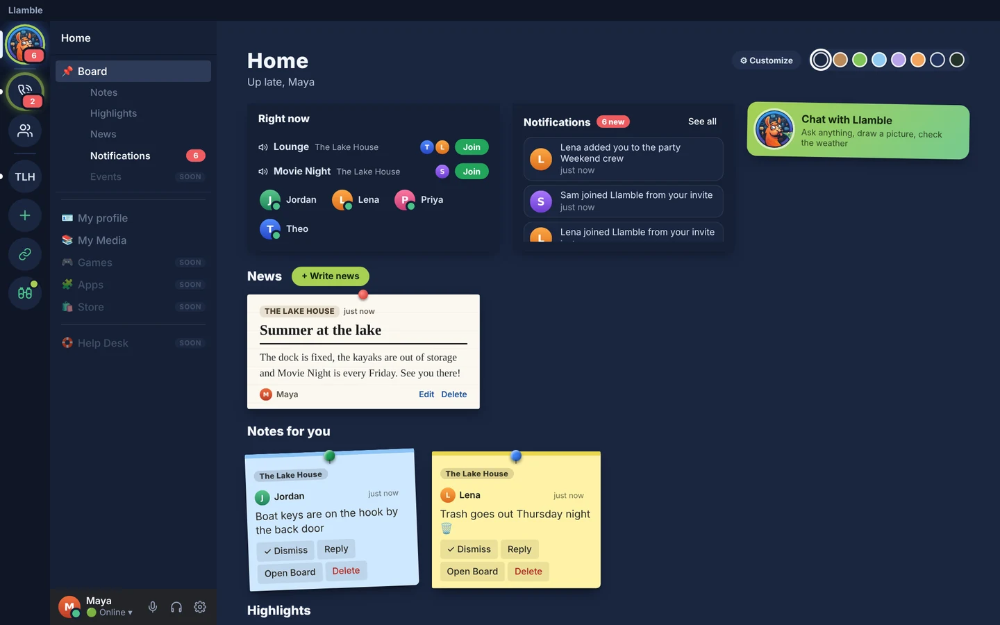
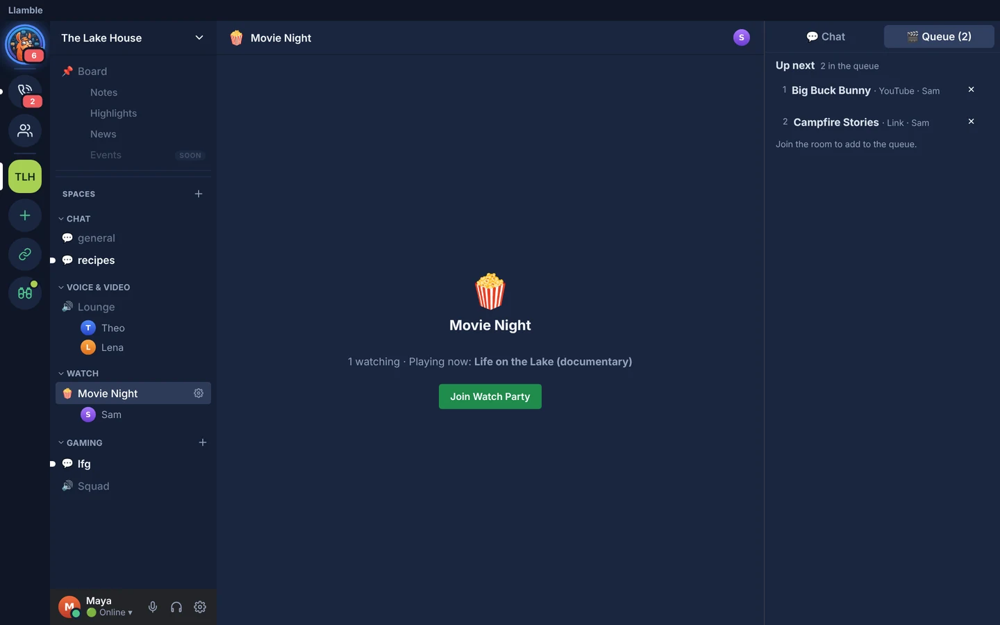
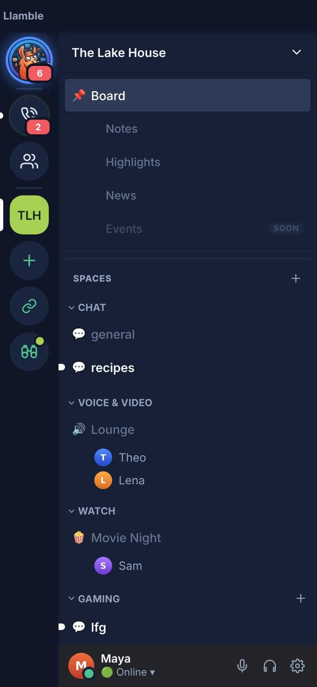
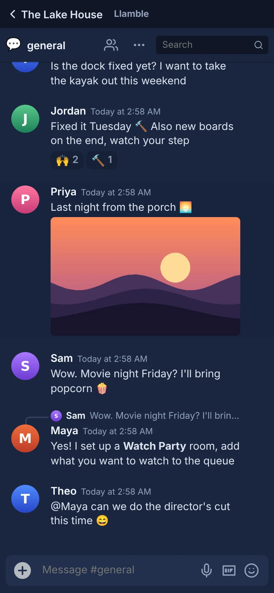
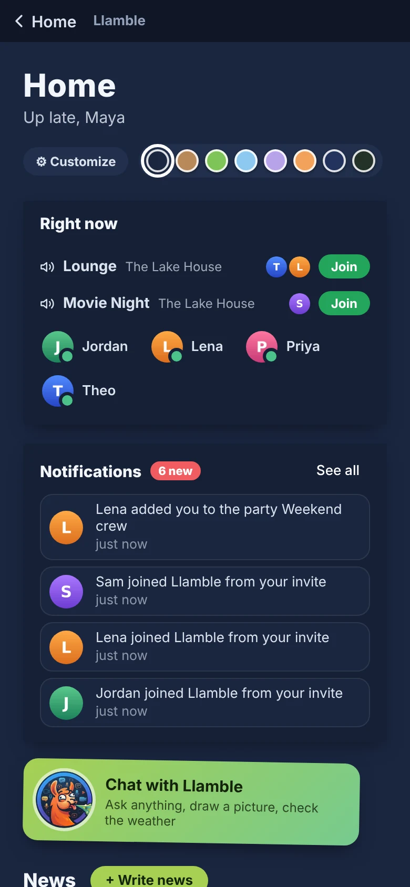

# Llamble

<p align="center"></p>

<p align="center"><b>Your own place to hang out.</b><br>Chat, voice, shows and more, on a server you run.<br>
Run it on a NAS or a Windows PC. Everyone joins from Windows, Android, or any browser.<br>
<a href="https://llamble.com">llamble.com</a> · <a href="https://github.com/eEPlanet/Llamble/releases/latest">Download</a></p>

<p align="center"></p>

<p align="center">


</p>
<p align="center">



</p>

## What it does

**Talk**
- **Servers made of spaces:** 💬 Chat, 🔊 Voice & Video and 🍿 Watch Party spaces sort themselves under their type. Staff can also make their own groups ("Gaming") and drag spaces into them.
- **Chat:** replies, reactions, markdown, @mentions, GIFs, link previews, pictures and video, files, voice messages, search, unread markers, and who's reading the chat right now.
- **Voice & video rooms and calls:** camera, screen sharing with sound, push-to-talk, noise suppression, per-person volume, "Mute people", and calls that ring like a phone.
- **Voicemail:** missed calls go to voicemail, with your own recorded greeting or your own words read by a server voice. Urgent voice messages keep alerting until someone taps "Got it".
- **Friends and parties:** friend lists with status and what people are playing, private notes, favorites, and parties (small groups with their own chat and voice).

**Watch together**
- **Watch Party rooms:** a shared player with a queue for YouTube, links and streams, an uploaded movie library, your own **Jellyfin** server, or a video from someone's device. It stays in sync for everyone, with voice and chat beside it.
- Whoever queued something (or a Watch Party host) runs it; everyone else can vote to skip. Late joiners come in quietly and can ask to talk. Posters and subtitles included.

**Find your people**
- **Open servers:** a server can be Open, Look around then request, Request only, or Invite only. Open and listed ones show up in a searchable list (the binoculars), and requests go to that server's staff.
- **Invites:** in-app invite cards, invite links, and "Invite someone to Llamble" for any member. Invites can make you friends with whoever joins.
- **Home board:** who's in a room right now, notifications, news, notes and highlights from all your servers in one place.
- **Tutorial:** new accounts get a short tour of the real app with a practice server (pretend people, messages and rooms, so nothing reaches anyone). It follows what each person can do here, staff tools included, skips parts that are turned off, and can be replayed from **Settings → Tutorial**.

**Shows and recording**
- Record a show from a voice room with a director's controls and layouts; record your screen or a game on your own graphics card; instant replay.

**Optional AI, all on your server**
- A chat assistant powered by llama.cpp (pick a model in the app). "Hey Llamble" in voice rooms, with speech-to-text and a natural voice, all running locally. Members can lend an idle gaming GPU. Off if you don't want it.

**Families**
- Kid accounts with parents who can read their chats, approve who they talk to and which servers they join, set quiet hours, and turn on kid-safe AI.

**Your server, your rules**
- Accounts are invite-only. Roles and permissions per server, lockable spaces, bans, auto-delete, and admin tools.
- Reach it from anywhere with your own address (HTTPS set up for you), directly or through your own relay so your home IP stays private.
- No ads, no tracking. Everything stays on your server.

```
llamble/
  server/        Rust (Axum + SQLite): API, WebSocket gateway, files, voice and AI management
  client/        React app: the Windows app (Electron) and the web app the server serves
  android/       The Android app
  server-app/    Llamble Server for Windows (tray app + installer)
  site/          llamble.com (GitHub Pages)
  deploy/        TrueNAS compose YAML (self-contained)
  tests/         API and browser tests with stand-ins for outside services
  tools/         helper scripts (screenshots, third-party licenses)
```

## Deploy on TrueNAS SCALE (Install via YAML)

GitHub Actions builds the server image (`ghcr.io/eeplanet/llamble:latest`, public) and the Windows installer on every push to `main`. TrueNAS pulls the image, so nothing is copied to the NAS and no registry login is needed. The image includes everything: the web client, llama.cpp for the AI bot, and LiveKit for voice/video (Llamble runs and configures it itself, with its own generated keys).

1. **Apps → Discover Apps → ⋮ → Install via YAML.** Name it `llamble` and paste `deploy/truenas-compose.yaml` **as-is**. There's nothing to fill in. Storage (`llamble-data`) is created automatically on your apps pool.
2. **Run setup:** open `http://NAS_IP:8090` in a browser, or enter that address in the Llamble app. A fresh server shows the setup wizard:
   - **Admin account:** creates the owner. Setup locks once it exists.
   - **First server name:** optional; the AI bot is switched on in it.
   - **AI model:** pick from the list (sizes and RAM needs shown) or paste any Hugging Face GGUF repo and choose a quantization. It downloads in the background with progress, then runs on the NAS. Change it later under **Settings → AI Model**.
3. **Desktop app:** download the installer from this repo's Releases (`Llamble-Setup.exe`). It updates itself.
4. **Android app:** download `Llamble.apk` from the same Releases and open it on the phone (allow "install unknown apps" once). It offers its own updates. Built from `android/`: a small Java app with no libraries that runs the same web app.

Every other server setting is in the app for admins: **Settings → Settings & Updates** (upload limit, link previews, who can create servers, invites, Watch Party and Jellyfin, bot name, recording), **AI Model** (model and GPU sharing), and **Remote Access**.

### Accounts, kids and roles

- **Account levels:**
  - **Master Admin:** whoever ran setup. Runs the server itself: Server, AI Model, Remote Access, and admin levels. Can hand the role to someone else.
  - **Admins:** manage accounts, passwords and kid accounts.
  - **Users.**
  - **Kids.**
- **Server roles:** every server gets **Admin / Supervisor / Moderator / Guest** below its Owner.
  - Supervisor is meant to be tuned: tick the powers you want them to have.
  - Guest can read and listen but not post or talk.
- **Kid accounts:** made in **Settings → Family**, no invite needed. Each kid is linked to one or more parent accounts (any regular account). Parents can:
  - read all the kid's chats, DMs included
  - approve who the kid may DM, and which servers they may join (servers run by chosen people are OK'd automatically)
  - take the kid out of any server
  - set quiet hours and kid-safe AI, and choose whether the kid may delete messages
- **Forgot password:** three ways back in.
  - **Recovery code:** shown once at sign-up; make a new one in My Account.
  - **Ask:** an admin, or a kid's parent, approves, and the waiting screen then sets the new password.
  - **Email link:** works once the Master Admin adds an email account in Settings → Server.
- **Clearing messages:**
  - select-and-delete many
  - clear a channel
  - delete everything one person wrote
  - auto-delete after N days (per channel)
  - anyone can clear their own AI chat

**Forgot the admin password?** In TrueNAS open **Apps → llamble → Shell** (the `>_` icon next to the container) and run `llamble-server reset-password` to list accounts, then `llamble-server reset-password <username>` for a temporary password. Other users' passwords can be reset by an admin in **Settings → Instance Admin**.

**Updating the server:** push to `main`, wait for the Actions build, then **Update** the app in TrueNAS (`pull_policy: always`). Models and data survive updates.

### Access from outside your house (Settings → Remote Access)

Each install uses its own address and, optionally, its own relay. Nothing goes through a shared Llamble service. Pick one:

- **Home only** (default): only devices on your network can connect.
- **Direct:** your router forwards ports to the NAS.
  1. Choose how your address stays pointed at your home IP: **Namecheap**, **Cloudflare** (API token), **DuckDNS** (free `yourname.duckdns.org`, no domain purchase needed), **another provider's update URL** (No-IP, Dynu, afraid.org, …), or **I handle it myself** (router DDNS or a static IP). The app shows the steps for whichever you pick.
  2. Enter your address (e.g. `chat.example.com`) and the provider's password/token/URL.
  3. On your router, forward **443/tcp → NAS:8443**, **7881/tcp → NAS:7881**, and **7882/udp → NAS:7882**.
  
  Llamble re-checks every 10 minutes and moves calls to the new IP when it changes. Your home IP is visible to anyone who looks up the address.
- **Through your own relay:** hides your home IP; no router changes.
  1. Rent a small VPS with Docker (Oracle Cloud's free tier works, or about $4–6/month elsewhere).
  2. Run the one-line `docker run … llamble-server relay` command that the app shows. It contains your server's private relay key.
  3. Wherever your DNS is managed, point your address's A record at the VPS's IP (once), then enter the VPS IP and your address in Llamble.
  
  Your NAS dials out to the relay and proves it has the key. Visitors' HTTPS and call traffic then passes through that connection. HTTPS is end-to-end: the VPS never holds your certificate.

In both modes, Llamble gets and renews a **Let's Encrypt** certificate on its own, and serves the app, files and call setup on one HTTPS port. People outside use **https://chat.example.com** in the app or any browser, including Chromebooks. New invites use that address automatically. At home, `http://NAS_IP:8090` keeps working.

Accounts are invite-only, passwords are hashed, and everything outside is HTTPS. Keep TrueNAS and Llamble updated.

## Desktop app (Windows)

```sh
cd client
npm install
npm run dev        # dev mode (Vite + Electron)
npm run dist       # builds release/Llamble-Setup.exe locally (CI publishes releases automatically)
```

The installer registers the `llamble://` protocol, so invite links open the app.

## Server configuration (env)

Optional. Admins change the day-to-day settings in the app; these environment variables are only first-boot defaults or advanced overrides.

| Var | Default | |
|---|---|---|
| `LLAMBLE_DATA` | `./data` | SQLite DB, files, thumbnails, proxy cache, secret key |
| `LLAMBLE_BIND` | `0.0.0.0:8080` | |
| `LLAMBLE_MAX_UPLOAD_MB` | `500` | first-boot default (Settings → Server) |
| `LLAMBLE_GUILD_CREATE` | `admin` | first-boot default (Settings → Server) |
| `LLAMBLE_UNFURL` | `1` | first-boot default (Settings → Server) |
| `LLAMBLE_BOT_NAME` | `Llamble` | first-boot default (Settings → Server) |
| `LLAMBLE_BOT_WORKERS` | `admins` | first-boot default for GPU sharing (Settings → AI Model) |
| `LLAMBLE_BOT_MAX_TOKENS` | `1024` | |
| `LIVEKIT_URL` / `LIVEKIT_API_KEY` / `LIVEKIT_API_SECRET` | — | advanced: use your own external LiveKit instead of the built-in one |
| `LLAMBLE_LLAMA_URL` | — | advanced: use an external llama-server instead of the built-in one |
| `HF_TOKEN` | — | optional: Hugging Face token for gated models |
| `LLAMBLE_IMAGE` | `ghcr.io/eeplanet/llamble:latest` | image name shown in the relay command (set it if you publish your own build) |
| `LLAMBLE_WEB_DIR` | `/app/web` in Docker | also serves the web client at `/` |
| `LLAMBLE_BOOTSTRAP_INVITE` | random | fixed first admin invite code |

**Backups:** everything lives in the `llamble-data` volume (`llamble.db` is SQLite in WAL mode), which sits inside the apps pool's `ix-apps` dataset. Snapshot that dataset.

## Tests

```sh
cd server && cargo build && cargo test   # unit tests
tests/run_all.sh                         # every API suite against a fresh server, with stand-ins for
                                         # llama-server, Hugging Face, Namecheap, LiveKit and a relay
```

## Coming next

- Cleanup tools for instance admins (scheduled cleanups with warnings and "Download my files")
- Forum and Blog spaces, Events, and a Help Desk with bug reports from every app
- Games inside Llamble (see [docs/GAMES_SDK.md](docs/GAMES_SDK.md))
- Per-space permission overrides; message pins and threads; custom server emoji
- Mac, Linux and iPhone apps

## Screenshots

The pictures here are made by `tools/screenshots/make_screenshots.py`, which fills a fresh server with
made-up people and chats and photographs it. Nothing in them comes from a real server.

## License

Llamble is **source-available**: free to use and to self-host, with the code public so anyone can
check what it does. It's licensed under the [PolyForm Shield License 1.0.0](LICENSE.md), which
doesn't allow using it to build or sell a competing service. [LICENSING.md](LICENSING.md) explains
what's allowed in plain English. Packs, themes and games from the Llamble Store have their own terms.

Third-party software and its licenses: [client/src/legal/third-party-licenses.txt](client/src/legal/third-party-licenses.txt)
(regenerate with `python3 tools/third_party_licenses.py` after changing dependencies).
Contributions: see [CONTRIBUTING.md](CONTRIBUTING.md).

## Llamble Server for Windows

For people without a NAS: `LlambleServer-Setup.exe` (on every release, and on llamble.com) installs the same
server (web app, voice server, AI, ffmpeg) with a small tray app (`server-app/`). It runs from the system tray,
restarts the server if it stops, can start with Windows, and keeps everything in `%LOCALAPPDATA%\Llamble Server`.
People connect to `http://THAT-PC-IP:8090` with the app or a browser, exactly as with a NAS. The installer adds
Windows Firewall rules (private networks) for the server and its voice server. Pictures and voice AI aren't in
the Windows build yet.
